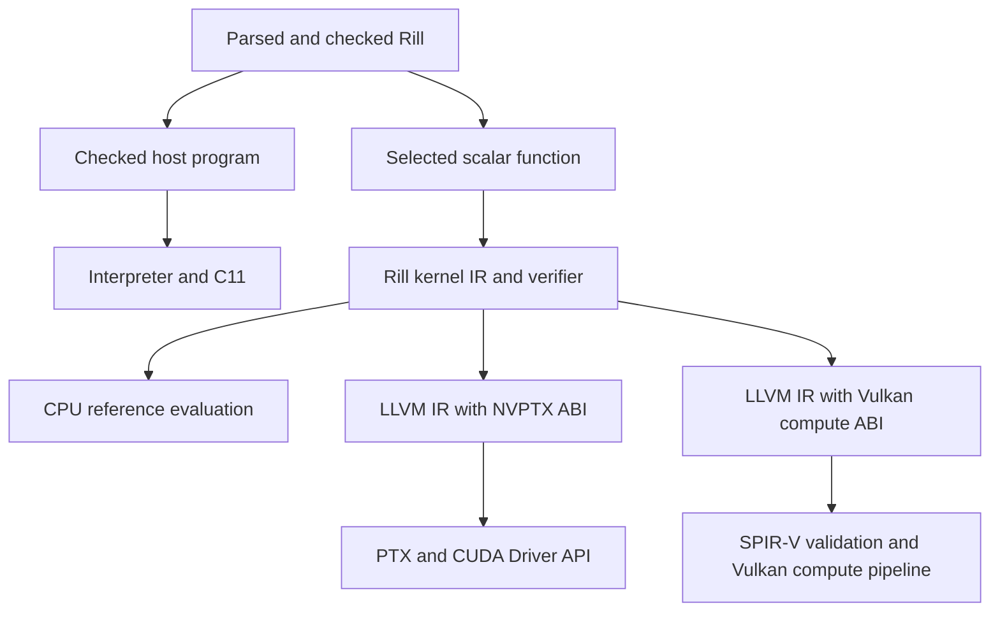

# Compiling Rill compute kernels with LLVM

Rill should own the meaning of a kernel all the way down to the last target-independent IR. A clamp over signed integers is a good first test. A negative number exercises signed comparison, a partial workgroup exercises bounds, and two real driver interfaces exercise memory layout. It is small enough to tell which layer introduced a wrong result.

The branch includes a versioned textual IR, its Rust verifier and evaluator, and emitters for CUDA PTX and Vulkan compute SPIR-V. The executable profile is a one-dimensional map over signed 32-bit elements. C11 remains the first target for ordinary Rill programs. The `rill kernel` commands and public Rust API read, check, evaluate and emit LLVM IR with no LLVM SDK or GPU requirement. [IR implementation](../src/kernel_ir.rs) · [Checked source extraction](../src/kernel_source.rs) · [Worked IR](../examples/gpu-ir/clamp.rir)

## Where the IR belongs



There are two useful levels of representation. Rill's existing typed host IR carries logical types, places, initialization and cleanup, and already has verification, evaluation and C emission for supported programs. A future common middle IR should preserve those facts and the identity of source operations. The device profile decides which operations can cross the host/device boundary. For example, a caller-selected arena belongs in host IR, and a bounded device storage view belongs in kernel IR. A raw host pointer has no implicit conversion between them. Reuse checked instance discovery when device calls and generics arrive. Key each body by the resolved declaration and concrete logical arguments. Two source types with the same memory layout can still have different meanings. [Typed host IR](../src/typed.rs) · [Instance discovery](../src/typed/instances.rs) · [Checked exports](../src/typed/library.rs)

### Extending the common IR beyond maps

Give a module a version, resolved function identities, concrete logical types, definitions and source locations. A function records parameter passing modes and allowed effects. Model ordinary computed values with SSA definitions and explicit block arguments. Model addressable storage with a distinct place consisting of an allocation or local and a field or index projection. A block argument can carry an `i32` across a branch. A place can carry an initialized owner whose move, borrow and destruction must be checked on each outgoing edge. This distinction lets the editor ask where a value came from and lets the C backend place a value on the stack when its address must be observable.

For `if let Some(x) = lookup(id) { use(x) } else { fallback() }`, lower `lookup` once. Branch on its tag, bind its payload only on the success edge, and pass the result from each arm into the continuation's block argument. Insert any required drops on their respective edges. For a scalar, pure, total conditional, device extraction may replace the branch and merge with `select`. A host allocation or effectful fallback requires the original control flow. This is a concrete case for keeping ownership, branch effects and source origins until after target selection.

Build the common IR incrementally. First give supported scalar exports a deterministic typed dump and round-trip it through verification. Then add explicit blocks and places to the existing owner path. Verify referenced symbols and types, block arguments and dominance, initialization at joins, non-overlapping loans and cleanup on every exit. Device extraction adds its own address-space, resource-access and convergence checks. Give each verifier failure an operation/source location and a rule identifier usable by CLI and LSP diagnostics. Newly lowered host operations need interpreter/C11 agreement on results, observable failure and destruction before becoming the default path. A machine-readable encoding can follow once two independent consumers agree on the textual semantics.

### A public, inspectable kernel IR

The source entry is ordinary Rill. Device selection happens at the call to the compiler.

```rill
export fn clamp(input: i32) -> i32 {
    if input < 0 { 0 } else { input }
}
```

The same body can be expressed directly as `rir 0`. Symbolic names in this listing make the operands readable. The source extractor assigns deterministic numbered names.

```text
rir 0
kernel map.i32 workgroup_x 64
%zero = const.i32 0
%negative = slt.i32 %input %zero
%clamped = select.i32 %negative %zero %input
return %clamped
```

`%input` is the signed `i32` in this lane. Every named result has one definition. `slt.i32` returns a private boolean. `select.i32` takes a boolean and two `i32` values. Constants cover the full signed range. `return` supplies exactly one `i32` result and ends the body. The verifier checks the version, profile, arity, definition order, distinct names, operand types and result before evaluation or emission. It bounds input to 64 KiB and 256 instructions plus the return. Names beginning with `%` are local to the body. Comments start with `//`. The emitter assigns its own LLVM identifiers. The Rill names never become unchecked fragments of LLVM syntax.

The profile header also has semantics. For every index `0 <= i < n`, load `input[i]`, evaluate the body, and store `output[i]` exactly once. All other lanes skip input and output access. On Vulkan every lane first reads the immutable count descriptor. The wrappers implement that control flow explicitly, before forming data-element addresses. Source code cannot change the index or access another lane in this profile. The predicate controlling the tail uses an unsigned index comparison. The example inside the map uses a signed *value* comparison. This distinction matters at `i32::MIN`. [CUDA wrapper](../examples/gpu-ir/clamp-nvptx.ll) · [Vulkan wrapper](../examples/gpu-ir/clamp-vulkan.ll)

The [source example](../examples/gpu-ir/clamp.rill) is an ordinary Rill function. `rill kernel lower` resolves its entry module, runs the library type checker and selects the named definition. The inferred or written signature must resolve to a monomorphic by-value `i32 -> i32`. Within the body the extractor accepts the input parameter, representable signed literals and nested `if` expressions whose predicates compare two supported values with `<`. It checks both branches. Unsupported calls, local bindings, arithmetic and other source forms give profile diagnostics. Source-located rejection also applies to traps in an unreachable arm. Its output passes through the same IR verifier as a handwritten file. Current public library entry points are `kernel_source::lower`, `Kernel::parse`, `Kernel::eval` and `Kernel::emit_llvm(Target)`.

The textual format is an experimental compiler interface. Keep the version and profile in saved fixtures and backend cache keys. Add a new version for incompatible changes. Keep the Rust representation and verifier authoritative and use one decoder for tooling, tests and code generation. Publish the grammar and compatibility policy before allowing independent producers to rely on it. The CLI writes deterministic textual artifacts to stdout. Carry optional source locations in a separate map when more transformations arrive.

## Try the two backends

Run the `cargo` commands on any Rust development machine. The LLVM and driver steps need the indicated targets. `llc --version` and `clang --print-targets` show which targets a build includes. The commands below use LLVM 21.1.8 for NVPTX and a Clang 22.1.8 build with the SPIR-V target for Vulkan. LLVM's Vulkan resource intrinsics are a toolchain-specific interface. Keep the exact release in CI. [LLVM NVPTX guide](https://llvm.org/docs/NVPTXUsage.html) · [LLVM SPIR-V target guide](https://releases.llvm.org/22.1.0/docs/SPIRVUsage.html) · [LLVM 22.1.8 resource lowering fixture](https://github.com/llvm/llvm-project/blob/llvmorg-22.1.8/llvm/test/CodeGen/SPIRV/hlsl-resources/StructuredBuffer.ll)

```sh
cargo test --locked --lib kernel_
cargo run --locked --quiet -- kernel lower examples/gpu-ir/clamp.rill clamp > /tmp/rill-map.rir
cargo run --locked --quiet -- kernel eval /tmp/rill-map.rir -2147483648 -1 0 7 2147483647

cargo run --locked --quiet -- kernel emit-llvm nvptx /tmp/rill-map.rir > /tmp/rill-map-cuda.ll
opt -passes=verify -disable-output /tmp/rill-map-cuda.ll
llc -march=nvptx64 -mcpu=sm_120 -mattr=+ptx87 -O0 /tmp/rill-map-cuda.ll -o /tmp/rill-map.ptx
python3 examples/gpu-ir/check_cuda.py /tmp/rill-map.ptx

cargo run --locked --quiet -- kernel emit-llvm vulkan /tmp/rill-map.rir > /tmp/rill-map-vk.ll
clang -cc1 -triple spirv1.5-unknown-vulkan1.2-compute -x ir -emit-obj /tmp/rill-map-vk.ll -o /tmp/rill-map.spv
spirv-val --target-env vulkan1.2 /tmp/rill-map.spv
spirv-dis /tmp/rill-map.spv -o /tmp/rill-map.spvasm
cc -std=c11 -Wall -Wextra -Werror examples/gpu-ir/vulkan-smoke.c -lvulkan -o /tmp/rill-vulkan-smoke
/tmp/rill-vulkan-smoke /tmp/rill-map.spv
```

The CPU run prints `0`, `0`, `0`, `7`, `2147483647`. `sm_120` identifies the NVIDIA board used for the hardware check. Select a supported architecture and PTX ISA for another device and driver. For optimized CUDA coverage, first run `opt -S -passes='default<O2>,verify'` on the emitted module and lower its output with `llc -O3`. PTX is an intermediate artifact. The CUDA driver can load and JIT it, or a compatible `ptxas` can produce a cubin for a specific architecture. Capture the actual tools, device, optional features and JIT diagnostics with the result. [NVIDIA module loading](https://docs.nvidia.com/cuda/cuda-driver-api/cuda_driver_api/group__CUDA__MODULE.html) · [PTX ISA](https://docs.nvidia.com/cuda/parallel-thread-execution/)

| ABI decision | CUDA via LLVM NVPTX | Vulkan via LLVM SPIR-V |
| --- | --- | --- |
| Device entry | `ptx_kernel void @rill_map` in `nvptx64-nvidia-cuda`. Two aligned device pointers in global address space 1 and one `u32` element count. | `rill_map` is a parameterless `GLCompute` entry point, logical addressing, SPIR-V 1.5 for Vulkan 1.2. Set 0 has three storage-buffer descriptors. Bindings 0, 1 and 2 contain input, output and the single `u32` count. |
| Index and dispatch | Read block and thread X, zero-extend, multiply block by 64 in `i64`, then add thread. Required block size is `64 × 1 × 1`. | Read X of global invocation ID. `LocalSize` is `64 × 1 × 1`. LLVM's Vulkan buffer handles lower to storage buffers with a four-byte array stride. |
| Validation | Verify LLVM, inspect PTX entry and target, load with the selected driver, then launch and compare bytes after synchronization. | Verify target environment with `spirv-val`. Inspect capabilities, entry, local size, bindings, access and stride. Create a pipeline on a device supporting the final artifact's capabilities and compare bytes after a fence. |
| Version-specific feature | Record the minimum SM and PTX version the tool actually emitted. | The LLVM 22.1.8 wrapper materializes resource names using `i8` constants. The raw binary declares `Int8`. Its launcher must query and enable `shaderInt8`, even though the map only uses `i32`. |

The Vulkan ABI is a shader pipeline contract. An OpenCL `spir_kernel` with pointer arguments and a `Kernel` execution model is a different public interface from a Vulkan `Shader` with descriptors. A successful universal SPIR-V validation is insufficient for this backend. Use `--target-env vulkan1.2` and verify that structured control flow survives every optimization. [Vulkan SPIR-V environment](https://docs.vulkan.org/spec/latest/appendices/spirvenv.html) · [Khronos SPIRV-Tools](https://github.com/KhronosGroup/SPIRV-Tools)

## What executed

The LLVM modules from the handwritten IR and the checked Rill source were byte-identical for each target. CUDA driver JIT on an NVIDIA GeForce RTX 5070 Ti ran the source-derived clamp at nine lengths in each of two optimization configurations. It preserved the input, inactive output lanes and boundary canaries. A second checked source function assigned three different results at the signed thresholds −5 and 42. Both optimization configurations matched an independent oracle for that kernel on the same hardware. The Vulkan 1.2 validator accepted the raw SPIR-V. The checked-in Vulkan harness dispatched it on Mesa llvmpipe at seven lengths including 63, 64, 65 and 129. This is software Vulkan execution. Both host programs exercise this specific clamp and own the buffers they allocate. [CUDA smoke harness](../examples/gpu-ir/check_cuda.py) · [Vulkan smoke harness](../examples/gpu-ir/vulkan-smoke.c)

The physical WSL D3D12 Vulkan adapter on the same RTX board reported `shaderInt8=false`, so the raw module produced an explicit skip there. The opt-in packaging experiment for the worked clamp optimizes the module with `spirv-opt --target-env=vulkan1.2 -O --trim-capabilities`. Disassembly still contained `OpCapability Int8` although the only remaining integer type was 32-bit. The packager checks the reviewed input and disassembly, removes that one stale declaration, reassembles, validates for Vulkan 1.2, and checks the output against the dispatched artifact. The resulting Shader-only module passed the same seven dispatches on both drivers. Reproduce it with the commands below. [Clamp packager](../examples/gpu-ir/package_vulkan_clamp.py)

```sh
python3 examples/gpu-ir/package_vulkan_clamp.py /tmp/rill-map.spv /tmp/rill-clamp-shader-only.spv
/tmp/rill-vulkan-smoke /tmp/rill-clamp-shader-only.spv
```

The D3D12 Vulkan driver reported itself nonconformant. Shipping a general Shader-only profile needs a pinned, reproducible compiler pass with capability inference, plus tests on a conformant physical Vulkan driver. Never drop a capability based solely on its absence from Rill source. [Vulkan capability requirements](https://docs.vulkan.org/spec/latest/appendices/spirvenv.html) · [Checkpoint results](verification/2026-11-21-systems-ml.md)

## Launch, memory and error contract

1. Make launch explicit. The proposed host operation takes a device, a kernel artifact and two typed slices with equal logical lengths. Represent each slice with a device and allocation identity, byte offset, element length, alignment and access mode. The output is exclusive and the input shared. Compare actual half-open byte ranges on the underlying allocation, including suballocations accessed through distinct handles. Adjacent ranges may pass. Reject partial and exact overlap. A future in-place map needs its own aliasing rule.
2. Before submission, verify `offset + 4 * n` with checked wide arithmetic, both storage ranges and any descriptor alignment. For Vulkan, put the validated `n` in a four-byte host-managed count slot. Lease those bytes immutably for the entire submission and reject overlap with the output using underlying allocation identity. Otherwise a lane can change the bound seen by a later lane. Check device ownership, buffer usage, available features, X group limit, local-size limit, storage range and the native driver's address/index limits. Reserve a conservative common profile where `4*n <= i32::MAX` until wide indexing is specified and tested. Vulkan access-chain indexing has signed-offset constraints. Compute workgroups as `n / 64 + (n % 64 != 0)` and reject an oversized launch. Use zero base and a one-dimensional grid. Handle an empty map as an immediate successful host operation. [Vulkan buffer indexing](https://docs.vulkan.org/spec/latest/appendices/spirvenv.html#spirvenv-buffer-indexing) · [Vulkan limits](https://docs.vulkan.org/spec/latest/chapters/limits.html)
3. Retain buffers, count storage, pipeline/module and descriptors until the stream event or queue fence signals completion. Prevent host mutation, remapping, release or overlapping submission during that lease. Arrange the appropriate transfer/compute/host memory dependencies and flush or invalidate noncoherent mappings as required. A device loss or asynchronous error retires the submission under an explicit failure policy. Its output cannot become an ordinary initialized Rill slice until success. [Vulkan synchronization](https://docs.vulkan.org/spec/latest/chapters/synchronization.html) · [CUDA Driver API](https://docs.nvidia.com/cuda/cuda-driver-api/)
4. Target-specific address spaces enter during LLVM lowering. Model storage, workgroup and per-invocation memory as separate Rill IR types before allowing user-supplied views. Allocate storage on the host through an explicit device allocator. Give workgroup scratch a static bound and a uniform initialization/barrier protocol. Keep scalar booleans private. Define aggregate layout, padding, alignment and tag width explicitly before transferring a Rill record or `Option`. CPU layout and Rill ownership alone cannot establish that byte ABI.
5. Preserve Rill's fault behavior. All v0 operations are total, so evaluation of the two values in a `select` is valid. For effectful or possibly trapping branches preserve real conditional control flow. Checked integer addition needs either a static range proof or an overflow result and a specified per-lane error/commit protocol. A trap, wrapped value or `nsw` promise can change observable behavior. Decide whether a failed dispatch can publish partial output before admitting such source operators. Add floating point under a separate profile with specified rounding, NaNs, denormals and contraction. Record any permitted relaxed math in the artifact. [LLVM language reference](https://llvm.org/docs/LangRef.html)

## Implementation sequence and review gates

| Step | Implementation | Evidence required before expanding it |
| --- | --- | --- |
| 1. Scalar map and reference | Freeze the small `rir 0` profile above. Decode and verify once and run scalar evaluation or either LLVM emitter from the same value. Keep the IR reader available independently of the source compiler. | Test identity, constants, nested selection and signed extrema. Reject a forward reference, duplicate name, boolean return, unsupported instruction, excessive work and a malformed header. Compare the complete output buffer and untouched tail on both drivers. |
| 2. Source and diagnostics | Select an exact checked `i32 -> i32` function by name. Elaborate its pure, total scalar expressions into the profile. Preserve the source span and concrete type at each future IR operation, including inlined helpers. Reject calls, allocations, owner operations, FFI, recursion and effects outside the supported profile. | Differentially evaluate source and kernel IR, including nested conditionals and ill-typed dead arms. Show a source location at the first unsupported operation. Keep ordinary source checks effective for the whole compilation unit. |
| 3. Host integration and packaging | Build an artifact manifest from the verified kernel and final binary. Include IR/profile version, entry, bindings, count layout, workgroup dimensions, capabilities, compiler versions, target architecture and content hashes. Add an explicit host dispatch API implementing the range and lease checks above, plus a diagnostic for absent backends. | Exercise counts 0, 1, 63, 64, 65, 127 and 129, nonzero offsets, distinct handles to one allocation, adjacent and overlapping spans, count/output aliasing, short descriptors, count overflow, unsupported features, pending reuse and device loss. Synthesize oversized descriptors to test rejection without huge allocations. |
| 4. Structured middle IR | Extend the device IR with typed block arguments, structured `if`/merge and bounded loops. Check dominance, reachability, type and effect agreement at joins, and device address spaces. Share source IDs, instance discovery and diagnostic reporting with the host IR. Keep source effects, move/drop facts and logical types available during extraction. | Independent interpreter on generated well-typed programs. Reject malformed dominance, unstructured exits and conditional barriers. Check SPIR-V merge/continue structure and CUDA outputs under optimization. Extend the formal core with lane evaluation and guarded map equivalence before claiming a sound translation. |
| 5. Application kernels and performance | Start with integer voxel density or scene-instance transforms, then database predicate-to-mask over a contiguous integer column. Add compaction/reduction only after workgroup memory, uniform barriers and deterministic aggregation rules. Run host code for file I/O, UI, scene ownership and database commit. | Compare every result and row order to the CPU result. Measure JIT/cache warmup, host transfers, submission, device time, readback and total latency separately. Include small inputs that lose to CPU. Record data size, device, driver, tool versions and optimization settings. |

Start backend integration with Rust-owned, typed instruction builders and structured external `opt`/`llc`/`clang` arguments, capturing stderr separately. This lets a contributor reproduce lowering outside the compiler and isolates LLVM version differences at the emission boundary. Move to pinned LLVM library bindings when measured process overhead or source-level debug information justifies it. MLIR GPU/SPIR-V dialects are worth prototyping when structured loops, workgroup tiling and multi-stage optimization dominate implementation cost. Compare that prototype on the same corpus before adding another IR dependency. A direct SPIR-V writer would require independent layout, structural-control and capability machinery. Keep it an evidence-driven fallback if the upstream Vulkan backend cannot express an accepted profile. [MLIR GPU dialect](https://mlir.llvm.org/docs/Dialects/GPU/) · [MLIR SPIR-V dialect](https://mlir.llvm.org/docs/Dialects/SPIR-V/)

Keep generic dispatch separate from the smoke harnesses. Both smoke harnesses deliberately oversubscribe the grid so zero and tail guards are exercised on the device. The general host contract above short-circuits empty maps.

Run verifier, evaluator and negative tests on ordinary CI. Install the pinned LLVM targets and `spirv-val` in an offline-artifact job. Run Vulkan software compute there when available. Keep hardware CUDA and hardware Vulkan as individually reported jobs with device identifiers and explicit capability skips. A validator can establish structural legality, a driver test can expose ABI errors, and source/IR differential tests can expose semantic mismatches. Each measures a different part of the contract. [Checkpoint evidence](verification/2026-11-21-systems-ml.md) · [Open gates](blockers/systems-ml.md)
